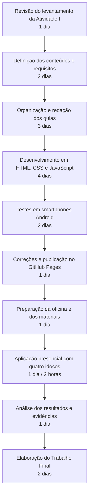

# Metodologia e cronograma

O projeto utiliza uma abordagem sequencial simples, compatível com seu tamanho. No Trabalho Final, substitua as durações planejadas pelas durações reais.

## Recursos previstos

- notebook para desenvolvimento;
- conta GitHub e GitHub Pages;
- smartphones Android dos participantes;
- conexão Wi-Fi;
- material impresso;
- celular para fotografias e vídeo;
- autorizações de imagem e voz.
